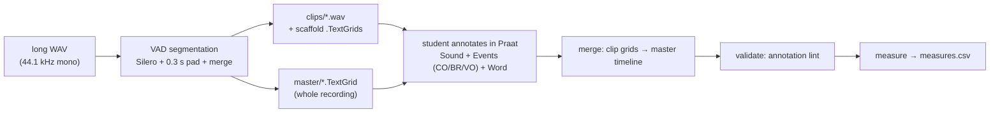

# Awngi stop-consonant research

Long-form speech recordings → automatically segmented utterances with
**Praat-ready TextGrids**, manual linguistic annotation, and automated acoustic
measurement (VOT, closure duration, burst estimate, spectral moments, cepstral
coefficients) for Awngi stop-consonant research.



## Quickstart

Requirements: Python 3.10+, [ffmpeg] on PATH, macOS/Linux.

```bash
python3.10 -m venv silero_venv
source silero_venv/bin/activate
pip install -r requirements.txt

# 1) segment a recording (VAD -> clips + Praat grids + manifest)
python -m pipeline segment audio/1203_spm37_intervocalic.WAV

#    -> out/1203_spm37_intervocalic/{master,clips,manifest.json,vad_raw.json}

# 2) student annotates in Praat (see docs/HOWTO-student.md), then:
python -m pipeline merge out/1203_spm37_intervocalic        # per-clip work -> master
python -m pipeline validate out/1203_spm37_intervocalic     # consistency lint
python -m pipeline measure out/1203_spm37_intervocalic --csv measures.csv
```

All commands are idempotent; re-running `segment` with changed parameters or a
changed source file is refused (use `--force`) so student annotations can never
be silently orphaned.

## Repository layout

```
AGENTS.md                  project status & context for AI-assisted sessions
audio/                     real recordings + the student's original TextGrids
pipeline/                  the pipeline package (CLI: python -m pipeline …)
  vad.py                   Silero VAD, sample-precision timestamps, pad+merge
  segments.py              ffmpeg clip cutting + naming
  textgrid.py              Praat TextGrid generation / rebase (praat-textgrids)
  manifest.py              JSON bookkeeping + provenance + id-stability guard
  merge.py                 annotated clip grids -> master grid
  validate.py              annotation consistency lint
  measure/                 measurement engine (tiers -> CSV, DSP features)
praat_scripts/             in-Praat cross-check script (stop_measures.praat)
docs/HOWTO-student.md      visual step-by-step guide for the annotator
docs/pipeline.md           technical reference: schemas, formulas, defaults
examples/                  worked example grid + sample measures.csv
tests/                     pytest suite (round-trips on the REAL data)
out/                       generated output (gitignored)
silero_segment.py          original baseline script (kept for reference)
```

## Tests

```bash
python -m pytest tests/ -q
```

The suite validates the pipeline on the real recordings in `audio/`:
segmentation determinism, clip/grid integrity, Praat-format round-trips, and a
split→merge fuzz test that slices the student's actual annotations into clip
grids and re-merges them (labelled content must survive exactly).

## Notes

- Audio is never resampled or normalised: clips keep the source format
  (44.1 kHz mono PCM16), which Praat expects for native-rate analysis.
- TextGrids are written in Praat long-text format (UTF-8); the tools read back
  every Praat flavour, including the UTF-16 files Praat itself saves on macOS.
- `praat-textgrids` is GPLv3 — fine for internal research use.
- `silero_segment.py` predates this pipeline and is kept as a baseline reference.

[ffmpeg]: https://ffmpeg.org/  (e.g. `brew install ffmpeg`)
